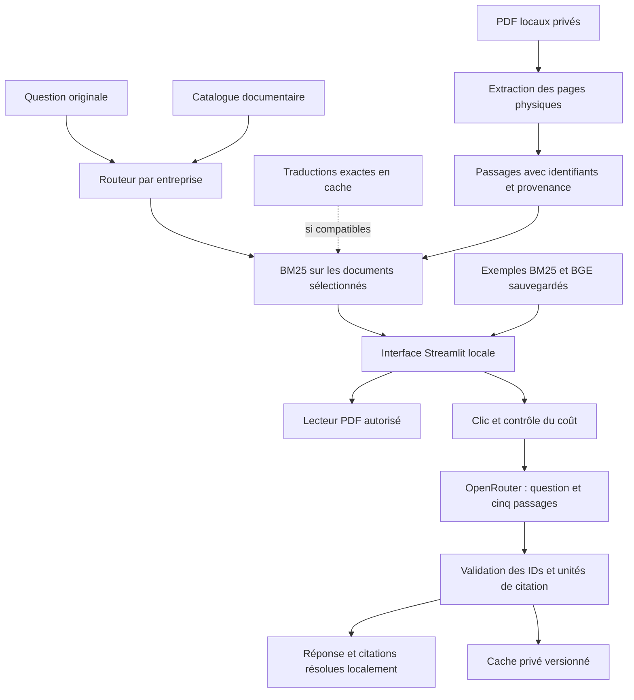

# FinRAG Studio

Une application locale pour retrouver des passages dans des rapports financiers,
consulter leurs pages sources et, sur demande, générer une réponse citée.

Une valeur financière n’est interprétable qu’avec sa société, son périmètre,
sa période, sa devise et son unité. FinRAG Studio conserve la provenance physique
des passages et rend ces vérifications accessibles dans le PDF. Le prototype
ne certifie ni l’exactitude d’une réponse ni sa suffisance financière.

## Fonctionnalités disponibles

- **Poser une question** : routage déterministe par entreprise puis recherche
  BM25 locale. Une traduction existante n’est réutilisée que si la question et
  la langue cible correspondent exactement ; sinon, la question originale est
  recherchée. Aucun appel de traduction ou reclassement BGE automatique.
- **Explorer les exemples** : consultation des classements BM25 et BGE déjà
  calculés pour 28 questions dev. Le classement n’est pas exécuté maintenant ;
  ce parcours ne démontre pas une latence interactive de BGE.
- **Comprendre le fonctionnement** : explications du parcours et de ses limites.
- **Générer une réponse** : appel OpenRouter facultatif, après clic explicite,
  avec la question originale et les cinq premiers passages du classement choisi.
  Une réponse valide en cache peut être réutilisée sans nouvel appel.

Les sources montrent document, entreprise, page physique, aperçu, texte original,
identifiant et score typé. Le lecteur n’autorise que les PDF du catalogue local.
Les numéros imprimés peuvent différer des pages physiques, comptées depuis 1.

## Architecture



`domain/` définit les contrats ; `ingestion/` et `chunking/` conservent les sources ;
`retrieval/` contient recherche et reclassement ; `evaluation/` isole références
et mesures ; `generation/` gère requêtes, citations et cache ; `ui/` présente le
parcours. Les annotations ne servent ni au routage, ni au reclassement, ni à la
génération. Les expérimentations E5/FAISS restent séparées de l’interface ; sous
Windows, Torch et FAISS utilisent des processus distincts.

Les décisions et leurs compromis sont décrits dans [l’architecture](docs/architecture.md).

## Installation sous Windows

Prérequis : Python **3.12 ou 3.13**, PowerShell et accès à un index de paquets
pour l’installation. Depuis le dossier du projet :

```powershell
$Python = Read-Host 'Chemin vers Python 3.12 ou 3.13 installé'
& $Python -m venv .venv
& .\.venv\Scripts\python.exe -m pip install -e '.[ui,dev]'
& .\.venv\Scripts\python.exe -m pip check
```

Le chemin demandé doit désigner un exécutable Python existant. Le lanceur `py`
peut être absent ou ne connaître aucun Python installé ; il n’est pas requis.

Cette installation suffit à l’interface, à BM25, à la génération OpenRouter et
aux tests ciblés de l’interface. Elle ne télécharge pas de modèle. Les dépendances
optionnelles `retrieval` servent aux expériences locales E5/BGE et FAISS ; elles
ne sont pas nécessaires pour afficher des classements sauvegardés.

**Les données privées ne sont pas distribuées.** Une copie publique permet
de tester les composants avec des données synthétiques ; la démonstration
financière nécessite les extractions, candidats et caches privés compatibles.
Déposer simplement un autre PDF ne reconstruit pas ces artefacts. Les chemins et
contrôles requis figurent dans [les entrées de l’interface](docs/local_ui.md).

## Lancement local

```powershell
& .\.venv\Scripts\python.exe -m streamlit run .\src\finrag\ui\app.py `
  --server.address 127.0.0.1 --server.port 8501 `
  --server.headless true --server.fileWatcherType none `
  --browser.gatherUsageStats false
```

Ouvrir **http://127.0.0.1:8501**. Arrêter avec **Ctrl+C** avant de redémarrer.
Aucun service cloud, base de données ou authentification n’est installé.

## OpenRouter : configuration et coûts

La recherche fonctionne sans clé. Pour une nouvelle génération, configurer la
clé dans le terminal qui lance Streamlit, sans l’afficher ni l’inscrire dans un
fichier public :

```powershell
$generationSecret = Read-Host 'Clé OpenRouter' -AsSecureString
$env:OPENROUTER_API_KEY = [System.Net.NetworkCredential]::new('', $generationSecret).Password
Remove-Variable generationSecret
$env:OPENROUTER_GENERATION_MODEL = 'mistralai/mistral-large-4-0'
```

Cet identifiant est un exemple explicite, sans modèle par défaut ni substitution
silencieuse. La variable initialise la sélection ; le modèle reste sélectionnable
dans la barre latérale. Aucun fichier `.env` n’est chargé automatiquement.

**Actualiser le catalogue**, dans **Paramètres avancés**, effectue uniquement
un GET public de métadonnées OpenRouter et ajoute un snapshot local daté. Aucun
texte documentaire n’y est envoyé. Le catalogue doit déclarer les capacités
requises, notamment la sortie JSON structurée ; une incompatibilité bloque la
génération. Le fournisseur peut encore refuser une requête déclarée compatible.

La sortie est initialement limitée à **1 024 tokens**. Pour Mistral Large 4,
`reasoning.effort=none` est présélectionné seulement si le catalogue le permet.
Les paramètres envoyés sont consultables avant l’appel. Aucun retry automatique.

Les tarifs sont ceux du snapshot daté, affichés en USD par million de tokens.
Sans compteur d’entrée compatible, l’interface affiche **Coût total inconnu**
et exige un consentement explicite. La réservation calculée pour la sortie est
**partielle** ; le budget estimé ne garantit pas un plafond de facturation.
Le coût et l’usage déclarés après l’appel sont conservés lorsqu’ils sont fournis ;
une valeur absente ne vaut pas zéro. Vérifier aussi les limites du compte fournisseur.

Seuls question et passages sont transmis lors de la génération : aucun PDF,
chemin local, annotation ou secret dans le contexte. Les réponses et diagnostics
restent privés. Voir [le guide de démonstration](docs/local_demo.md).

## Résultats mesurés

Les chiffres suivants proviennent des sorties sauvegardées, sans nouvelle
évaluation à l’occasion de cette documentation. Le périmètre est constitué de
**28 questions dev répondables**, sur trois rapports BNP Paribas, Crédit Agricole
S.A. et Société Générale. Les deux questions dev non répondables sont séparées.
Les références v1 restent candidates ; leurs ambiguïtés limitent l’interprétation.

| Configuration | Hit@1 | Hit@5 | Extraits complets @5 | Extraits complets @50 |
|---|---:|---:|---:|---:|
| Routage réel + BM25, traductions corrigées en cache | 5/28 | 11/28 | 11/28 | 20/28 |
| BGE local sur les mêmes 50 candidats et requêtes | 9/28 | 16/28 | 16/28 | 20/28 |

Les entrées sont les **8 325 passages** de contrôle Phase 2B ; BM25 conserve
`k1=1.2`, `b=0.75` et le tokenizer `unicode-financial-v1`. La comparaison BGE
réordonne le même pool : elle ne peut pas récupérer une preuve absente de celui-ci.
Le cache CPU contient 28 sorties réussies. À @5 : six gains, une régression.
La couverture complète manque dans le pool pour huit questions ; quatre autres
échecs à @5 concernent des preuves disponibles mais moins bien classées.

**Hit@k** mesure la présence d’au moins une page v1 du bon document parmi les
k passages. Il ne requiert pas toutes les preuves d’une comparaison.
**Extraits complets @k** exige que chaque extrait v1 figure textuellement dans
un passage de sa page physique annotée. Ce contrôle ne valide pas automatiquement
la période, le périmètre ou la justification financière d’une réponse.

Sources des mesures : `artifacts/private/bge_reranker_dev/evaluation_cpu.json`,
les caches associés et les diagnostics privés. Ces fichiers ne sont pas publiés.
L’expérience réutilise des traductions dev dont certaines ont été corrigées
linguistiquement ; elle ne valide pas une traduction autonome de nouvelles questions.
Les oracles documentaires utilisent le document annoté et ne sont pas du routage réel.

À titre historique, la Phase 2B globale, sans ce routage, mesure Hit@5 : BM25
apparié **9/28**, E5 **1/28**, hybride fixe **3/28**. Ces résultats restent
distincts du tableau ci-dessus. La Phase 2A utilisait une autre segmentation.
Les détails sont dans [la validation Phase 2B](docs/phase2b_validation.md).

## Vérifications

Les tests emploient des PDF, vecteurs et fournisseurs synthétiques, sans modèle
réel ni lecture des données test réelles. La suite complète requiert aussi
l’extra `retrieval` pour ses tests FAISS et les contrats de dépendances ML :

```powershell
& .\.venv\Scripts\python.exe -m pip install -e '.[ui,dev,retrieval]'
```

Cette installation optionnelle télécharge des paquets, pas les poids des modèles.
Une installation GPU adaptée est une procédure distincte ; les tests n’exigent
pas de GPU. Depuis le dossier du projet déjà équipé :

```powershell
$validationTemp = Join-Path $env:TEMP ('finrag-tests-' + [guid]::NewGuid().ToString('N'))
& .\.venv\Scripts\python.exe -m pytest -q -p no:cacheprovider --basetemp $validationTemp
& .\.venv\Scripts\python.exe -m ruff check src tests
& .\.venv\Scripts\python.exe -m ruff format --check src tests
& .\.venv\Scripts\python.exe -m pip check
```

Un dossier temporaire court hors OneDrive limite les interactions avec les
chemins longs et la synchronisation ; pytest recrée ce dossier dédié. Ne pas y placer
de données de recherche. Les commandes d’installation sont documentées, mais
aucune réinstallation n’est nécessaire pour lancer les contrôles d’un environnement
déjà préparé. Voir [la revue de publication](docs/publication_review.md).

## Limites et données

- Extraction textuelle native ; aucune garantie de reconstruction des tableaux
  ni de traitement OCR des pages scannées.
- Routage sur noms explicites, sans interprétation automatique de l’exercice.
  Crédit Agricole S.A. et Groupe Crédit Agricole restent des périmètres distincts.
- BGE CPU est réservé ici aux exemples précalculés ; les nouvelles questions
  utilisent BM25. Aucun gain de précision de génération n’a été évalué.
- Un ID de citation valide garantit sa traçabilité, pas qu’il justifie l’affirmation.
  Le refus concerne les passages fournis, pas l’ensemble du corpus.
- Petit ensemble dev, documents partagés et références candidates : ces résultats
  ne démontrent pas une généralisation. Le split test n’est pas utilisé pour
  ces expériences ; il avait déjà été étudié par le prototype historique.

Les rapports, extractions, questions, annotations, modèles, index et caches restent
hors publication. La licence du code n’accorde aucun droit sur les documents
d’émetteurs ou les modèles tiers. Consulter [la politique des données](docs/data_policy.md),
[la provenance et les attributions](docs/provenance.md) et la [licence MIT](LICENSE).
